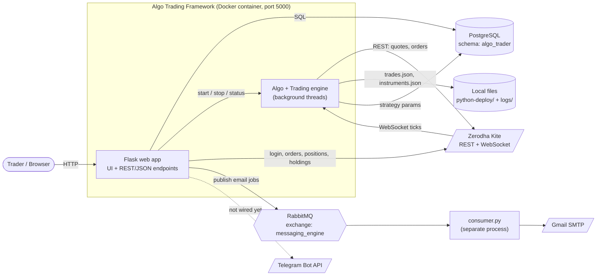
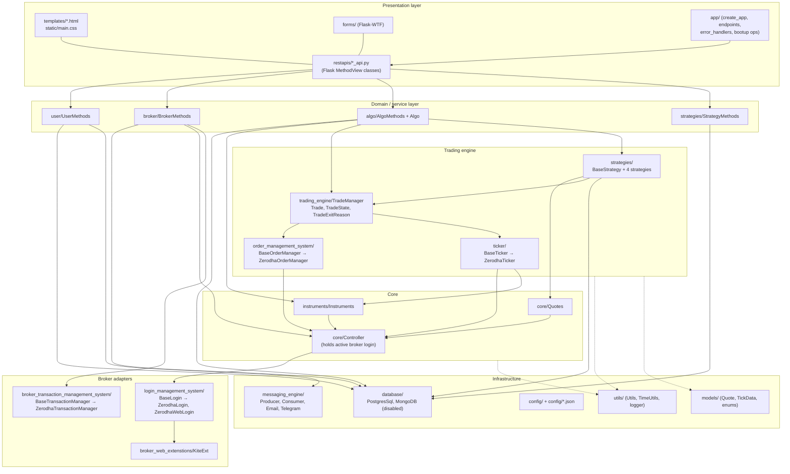
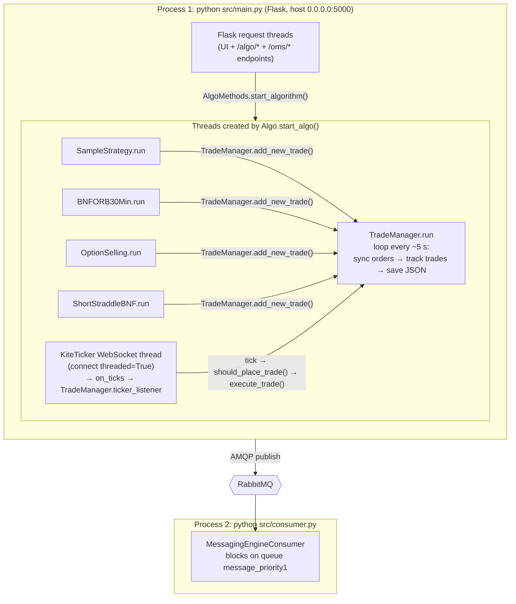
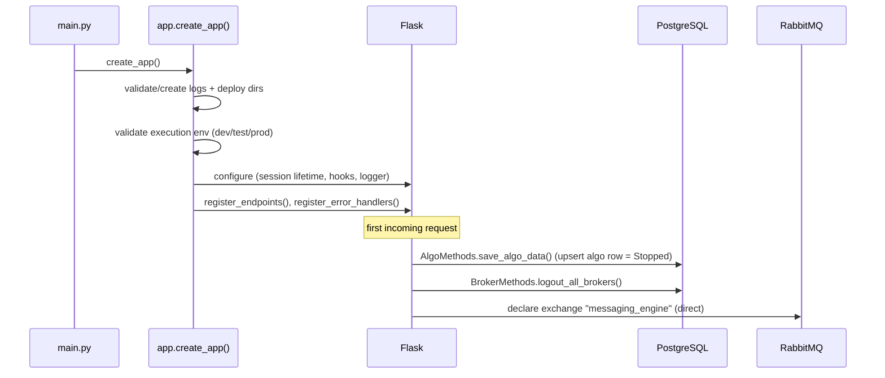
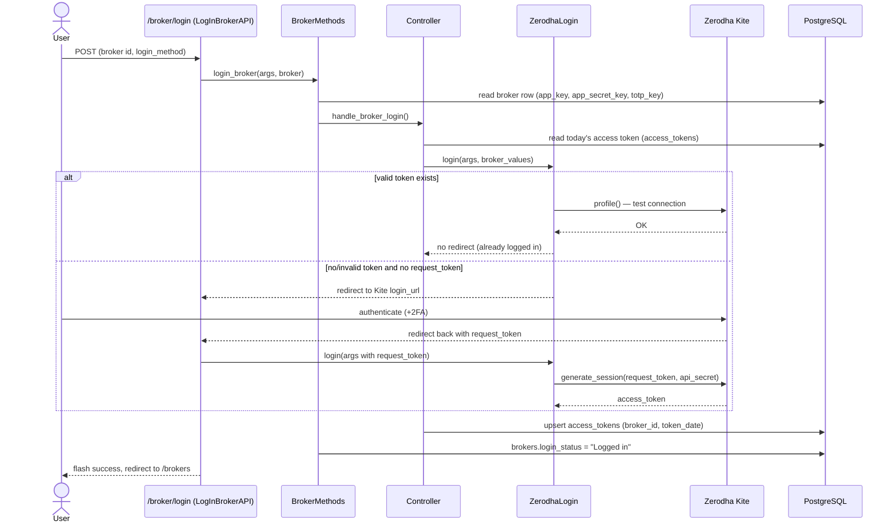
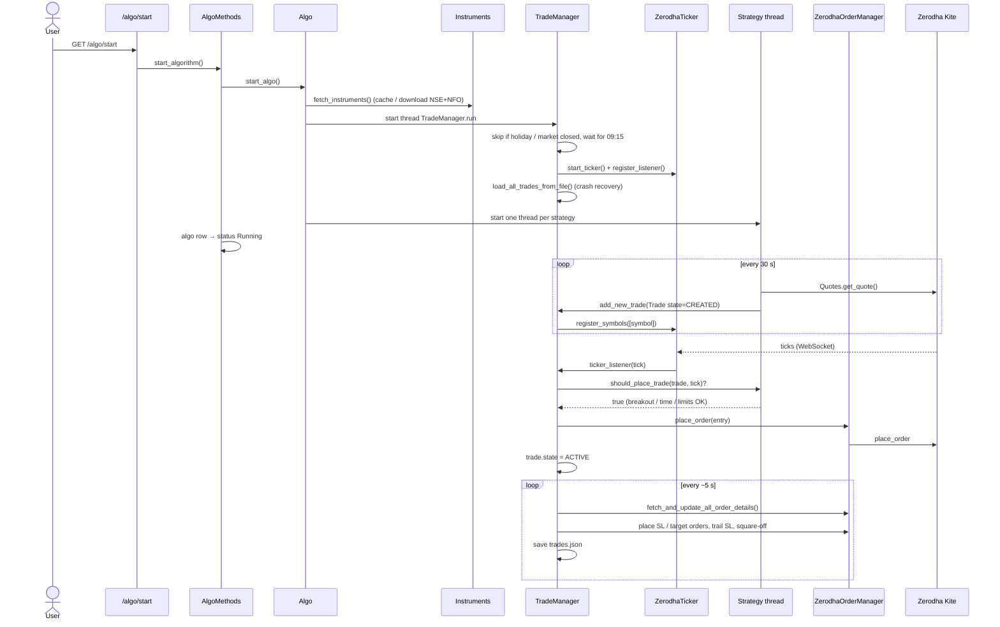
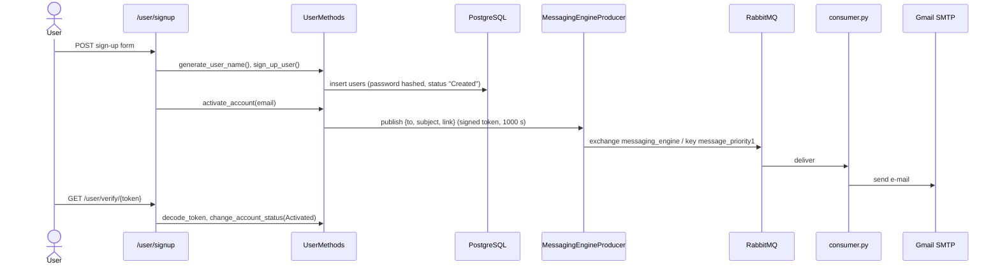
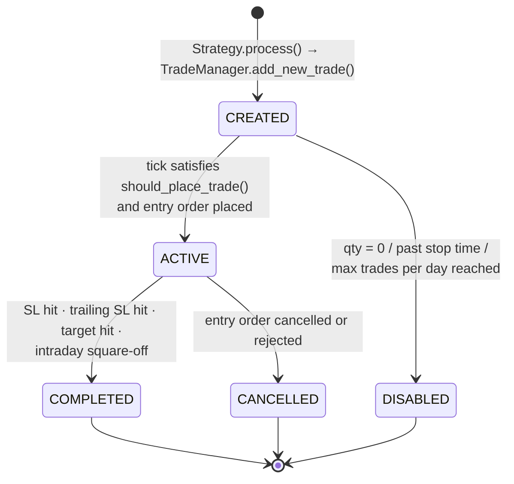
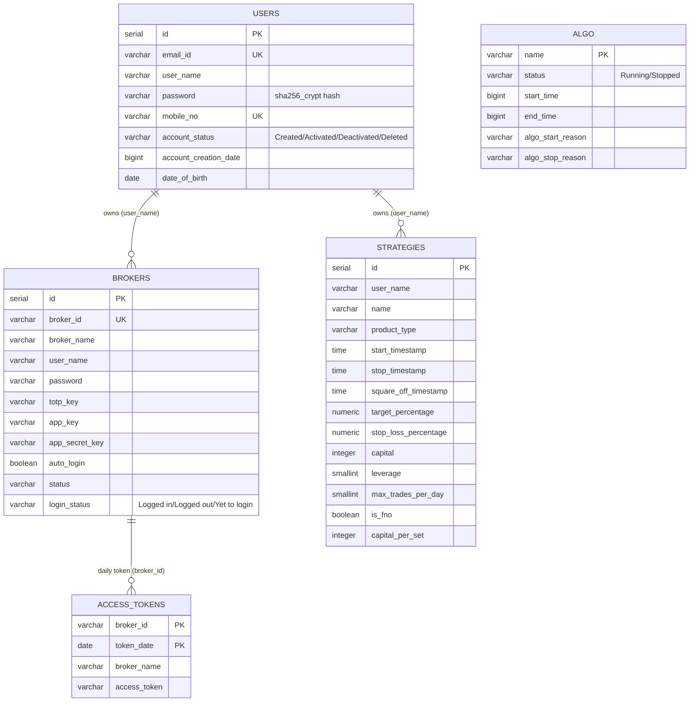
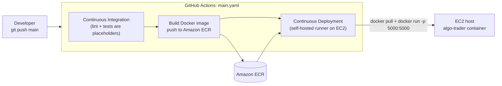

# Architecture

This document describes how the Algo Trading Framework is put together: the layers, the runtime processes and
threads, the main flows, and the data model. All diagrams are [Mermaid](https://mermaid.js.org/) and render
natively on GitHub and in most Markdown viewers.

- [1. System overview](#1-system-overview)
- [2. Layered component view](#2-layered-component-view)
- [3. Runtime view (processes and threads)](#3-runtime-view-processes-and-threads)
- [4. Key flows](#4-key-flows)
- [5. Trade lifecycle](#5-trade-lifecycle)
- [6. Data model](#6-data-model)
- [7. Deployment](#7-deployment)
- [8. Design patterns used](#8-design-patterns-used)

---

## 1. System overview

A user manages everything through a Flask web UI. The web app stores users, brokers, strategies and the algo
status in PostgreSQL, logs in to a broker (Zerodha Kite), and starts the algo. Once started, the trading engine
streams live ticks from the broker, lets each strategy create trades, places and tracks orders, and persists
intraday trades to a JSON file.

---

## 2. Layered component view

The code under `src/` is organised so that **broker-specific code sits behind base classes** and
**strategies only talk to the trading engine**, never to the broker directly.

### Module map

| Package | Responsibility |
|---|---|
| `app/` | `create_app()` factory, request hooks (session, DB handle), URL registration, error pages, one-time bootup operations |
| `restapis/` | One `MethodView` class per endpoint; thin: validate input, call a `*Methods` class, flash/redirect/return JSON |
| `forms/` | Flask-WTF forms (sign-up, login, profile, password change/reset, broker add/login) |
| `templates/`, `static/` | Jinja2 pages and CSS |
| `user/` | `User` entity, `UserStatus`, `UserMethods` (sign-up, login, tokens, passwords, profile, e-mails) |
| `broker/` | `Broker` entity, status enums, `BrokerMethods` (CRUD, login/logout, access tokens, orders/positions/holdings) |
| `core/` | `Controller` (the active broker login singleton) and `Quotes` (broker quote → internal `Quote`) |
| `login_management_system/` | Broker login strategies. `ZerodhaLogin` = official Kite API flow; `ZerodhaWebLogin` = user-id/password/TOTP or enctoken |
| `broker_web_extenstions/` | `KiteExt`, a `KiteConnect` subclass that talks to Kite's web front-end (enctoken auth) |
| `broker_transaction_management_system/` | Read-only account calls: profile (connection test), orders, positions, holdings |
| `algo/` | `Algo` (start/stop the engine), `AlgoMethods` (persist status), status/reason constants |
| `instruments/` | Download/cache the NSE + NFO instrument master; symbol ⇄ token lookup |
| `ticker/` | Live tick streaming (`ZerodhaTicker` over `KiteTicker`) and listener fan-out |
| `strategies/` | `BaseStrategy` template and the concrete strategies |
| `trading_engine/` | `TradeManager` (orchestrator), `Trade` entity, state/exit-reason enums, JSON encoder |
| `order_management_system/` | Order entity, input/modify params, broker order manager |
| `database/` | Thin psycopg2 wrapper (`PostgresSql`), table/schema name constants, Mongo wrapper (currently unused) |
| `messaging_engine/` | RabbitMQ producer/consumer, SMTP e-mail sender, Telegram sender |
| `config/` | Env configs (`DevConfig` etc.), loaders for `server.json`, `holidays.json`, `timestamps.json` |
| `utils/` | Market-time helpers, NSE price rounding, expiry/strike/symbol builders, P&L maths, logger setup |
| `models/` | Plain value objects and enums (`Quote`, `TickData`, `Direction`, `OrderType`, `OrderStatus`, `ProductType`, `Segment`) |
| `exceptions/` | Domain exception types for API, broker, strategy and user errors |

---

## 3. Runtime view (processes and threads)

There are two OS processes: the **web app** (`python main.py`) and the optional **consumer**
(`python consumer.py`). Starting the algo spawns additional threads **inside the web app process**.

Each strategy thread wakes every 30 seconds (aligned to :00/:30), calls its `process()` and sleeps. Trade
**triggering** is event-driven: every incoming tick is offered to the strategies that own a not-yet-triggered
trade on that symbol.

### Application start-up sequence

---

## 4. Key flows

### 4.1 Broker login (official Kite API flow, `api_with_broker_portal`)

The other two login methods (`creds_with_enc_token`, `creds_without_enc_token`) go through `ZerodhaWebLogin`
and `KiteExt`: either an enctoken supplied by the user is used directly, or the framework posts user id +
password and a generated TOTP to Kite's web login endpoints and reads the `enctoken` cookie.

### 4.2 Starting the algo and executing a trade

### 4.3 Account sign-up and e-mail verification

---

## 5. Trade lifecycle

While a trade is `ACTIVE`, `TradeManager` keeps three orders in sync: the **entry** order, a **stop-loss**
(SL-M) order and an optional **target** (LIMIT) order. Whichever of SL/target completes first causes the other
to be cancelled; at the strategy's square-off time the SL is cancelled and the position is closed with a market
order. See [Trading engine](features/trading-engine.md) for the details.

---

## 6. Data model

`ALGO` is a single-row control table (keyed by the algo name from `config.py`). Non-relational state lives in
files under the deploy directory:

| File | Purpose |
|---|---|
| `python-deploy/instruments.json` | Cached NSE + NFO instrument master (refreshed after 24 h) |
| `python-deploy/timestamps.json` | Bookkeeping, e.g. `instrumentsLastSavedAt` |
| `python-deploy/trades/<YYYY-MM-DD>/trades.json` | All of the day's trades with their orders; reloaded on restart |
| `logs/<YYYY-MM-DD>/app_<datetime>.log` | Application log |

---

## 7. Deployment

See [Configuration & deployment](features/configuration-and-deployment.md).

---

## 8. Design patterns used

| Pattern | Where |
|---|---|
| Application factory | `app.create_app()` |
| Class-based views | every class in `restapis/` extends `flask.views.MethodView` |
| Template method | `BaseStrategy.run()` is fixed; subclasses supply `process()`, `should_place_trade()`, `get_trailing_sl()`, `can_trade_today()` |
| Adapter / strategy per broker | `BaseLogin`, `BaseOrderManager`, `BaseTicker`, `BaseTransactionManager` with Zerodha implementations; selection by broker name in `Controller`, `BrokerMethods`, `TradeManager` |
| Observer | `BaseTicker.register_listener()` / `on_new_ticks()` fan-out to `TradeManager.ticker_listener` |
| Singleton | each concrete strategy (`get_instance()`), `SingletonMeta` for the messaging producer, `Controller` static state |
| Facade / service layer | `UserMethods`, `BrokerMethods`, `AlgoMethods`, `StrategyMethods` isolate REST views from SQL and broker calls |
| Producer / consumer | RabbitMQ direct exchange for asynchronous e-mail delivery |
