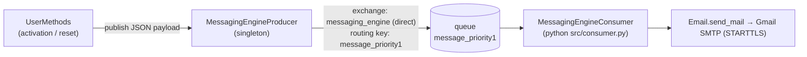

# Messaging and notifications

E-mails (account activation, password reset) are sent **asynchronously** through RabbitMQ so that web requests
do not wait on SMTP. A Telegram sender is included for alerts.

**Code:** `src/messaging_engine/` (`producer.py`, `consumer.py`, `email.py`, `telegram.py`), `src/consumer.py`

## Flow



## Components

| Component | Description |
|---|---|
| `MessagingEngineProducer` | Singleton (`SingletonMeta`) holding a blocking `pika` connection to `localhost`. `declare_exchange()` creates the direct exchange `messaging_engine`; `publish(payload)` sends JSON with routing key `message_priority1`. The exchange is declared on application start-up |
| `MessagingEngineConsumer` | Declares the queue `message_priority1`, binds it to the exchange, and for each message calls `Email.send_mail(payload)` then acknowledges it |
| `src/consumer.py` | Entry point that runs the consumer in its own process; loads `.env` and exits cleanly on Ctrl+C |
| `Email` | Sends `payload = {to, subject, message}` through `smtp.gmail.com` with STARTTLS using `EMAIL` / `EMAILPASS` |
| `Telegram` | Sends `payload['message']` to a chat through the Telegram Bot API using `TELEGRAMBOTTOKEN` / `TELEGRAMBOTCHATID`. Implemented but not yet called from application code (integration is in progress) |

## Payload

```json
{ "to": "user@example.com", "subject": "Account activation request", "message": "Click here to verify the account: http://…/user/verify/{token}" }
```

## Running it

1. Start a RabbitMQ broker on `localhost`.
2. Set the e-mail variables in `.env` (see [Configuration](configuration-and-deployment.md#environment-variables)).
3. Start the web app, then in a second terminal from `src/`: `python consumer.py`.

> If the consumer is not running, messages simply wait in the queue until it starts.
